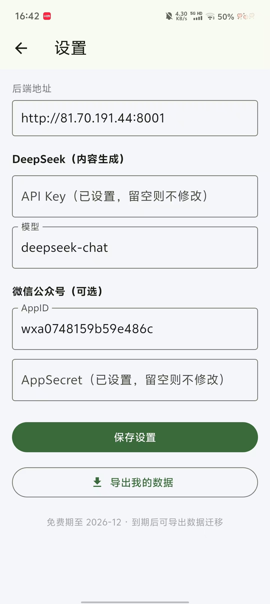
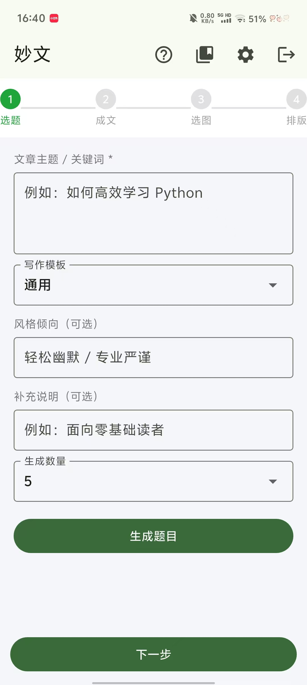
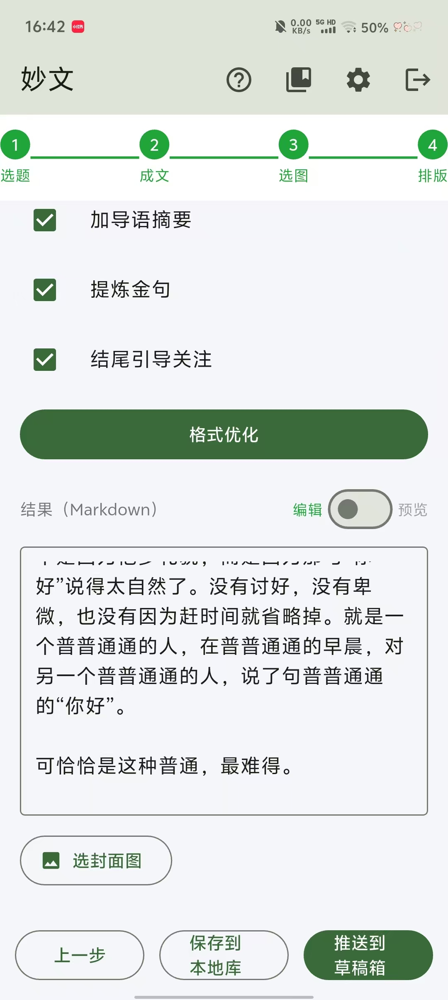

# 妙文：把「选题到发布」做成一条流水线的公众号写作助手


**后端 / 网页版**：[https://github.com/hong-red/Article-Agent-App](https://github.com/hong-red/Article-Agent-App)

**安卓客户端**：[https://github.com/hong-red/smart-elf-app](https://github.com/hong-red/smart-elf-app)

**网页版体验**：[http://81.70.191.44:8000](http://81.70.191.44:8000)

**作品展示（B站）**：[妙文 App 作品演示](https://www.bilibili.com/zh-Hans/video/BV1TvxL6REZC/)

## 项目概述

「妙文」取自「铁肩担道义，妙手著文章」，是一款面向个人自媒体与校园 / 单位公众号运营者的智能写作助手。它把写公众号这件琐碎的事拆成一条固定流水线：

```
选题 → 成文 → 选图 → 排版 → 推送到草稿箱
```

目标人群里特意包含**不熟悉大模型工具的中老年运营者**，所以整个交互尽量做成「点一下、选一个」的低门槛形式，而不是让人对着空白对话框发呆。

项目分成两个仓库协作：`Article-Agent-App` 是多用户云端后端（FastAPI + PWA 网页版），`smart-elf-app` 是配套的原生安卓客户端（Flutter）。两者共用同一套后端 API。

## 四步工作流

### 第一步：选题

输入主题，选写作模板 / 风格 / 补充说明 / 生成数量，AI 一次给出多个标题候选。内置「干货清单型」等模板，会隐式约束标题与正文的写法，比如清单型要求标题带「数字 + 实用价值」、正文用「总-分」结构。

### 第二步：成文

生成正文后可以反复「按意见重写」。这里做了两处让重写不那么「推倒重来」的设计：

- **带上上一版内容**：改稿时把 `previous_content` 一起喂给模型，提示「请基于这版修改，而不是完全重写」，避免每轮都得到一篇面目全非的新文章。
- **素材库引用**：可以把会议纪要、讲话稿、PDF 等文字素材上传进「本地库」，生成时勾选素材，后端会读出素材文本拼进提示词，让 AI 基于真实资料写作。

### 第三步：选图

支持本地上传，也支持**全网图片搜索**。搜索走必应图片、无需 API Key，并且刻意绕开系统代理直连，保证国内网络可达。选中的图片会被插入 Markdown 正文，位置不合适可以手动调整图片代码。

### 第四步：排版与推送

公众号正文不支持外部 CSS，所以排版环节把常见 Markdown 语法直接转成**带内联样式的 HTML 片段**，保证能原样推进草稿箱。提供默认蓝、商务蓝、温暖橙、清新绿、优雅紫、极简黑白等配色方案，还能加导语 / 金句 / 引导关注。确认无误后一键推送到微信公众号草稿箱。

## 双端形态

### 网页版（PWA）

前端是纯静态页（`static/`），带 `manifest.json` + `sw.js`，手机浏览器打开后可「添加到主屏」，像 App 一样使用，无需安装。

### 安卓客户端（Flutter）

原生 Flutter 界面，配合后端使用，功能与网页版对齐：登录注册、四步生成、本地库（保存 / 载入 / 删除）、设置、数据导出。小屏手机上还提供了「编辑 / 预览」模式切换，方便查看最终排版效果。





## 后端设计

从「自托管网页版」升级到「托管 App 版」时，多用户是最大的变化。后端为此补上了一整套账户体系：

| 关注点 | 实现方式 |
| --- | --- |
| 密码 | PBKDF2 加盐散列（SHA-256，12 万次迭代），不存明文 |
| 用户密钥 | DeepSeek Key / 公众号 Secret 用 Fernet 对称加密后存 SQLite |
| 会话 | 登录发随机 token，前端放 localStorage，请求带 `Authorization: Bearer <token>` |
| 隔离 | 文章 / 素材按 `user_id` 隔离，互不可见 |
| 注册 | 邀请码制，单码可注册名额可配（默认 `SMART2026`，200 个名额） |
| 迁移 | 提供「导出当前用户全部数据」接口，免费期结束后可自行迁移 |

主流程建立在 FastAPI 上，核心模块划分清晰：

```text
├── app.py         # FastAPI 后端（认证 + 生成 + 文章 + 导出）
├── db.py          # SQLite：用户/会话/邀请码/文章/素材
├── crypto.py      # 密码散列 + 密钥加密
├── llm.py         # DeepSeek 客户端（OpenAI 兼容接口）
├── imagesearch.py # 必应图片搜索 + 下载
├── markdown_html.py # Markdown → 微信内联样式 HTML
├── wechat.py      # 微信草稿箱推送
└── static/        # 前端 PWA
```

模型侧用的是 DeepSeek（OpenAI 兼容接口），调用封装在 `llm.py` 里，统一处理 Key 缺失、请求失败、响应解析等异常。

## 开发踩坑记录

### 公众号推送的 IP 白名单

**问题**：调用微信接口报 `40164`，推送直接失败。

**解决**：微信公众号要求调用方服务器的**公网出口 IP** 加入白名单。注意是**服务器**的 IP，不是开发者自己电脑 / 手机的 IP。后端专门提供了一个探测接口（`/api/wechat/ip`）方便查出服务器公网 IP。若服务器有多条出口线路，需要全部加入。

### 个人订阅号用不了草稿箱接口

**问题**：部分公众号推送报 `48001`。

**解决**：草稿箱推送接口要求公众号为**已认证的服务号**，个人订阅号无法使用。这一条在文档里重点标注，避免用户白折腾。

### 导出与密钥安全

**问题**：服务端要存用户的 DeepSeek Key 和公众号 Secret，一旦泄露风险很高。

**解决**：用 Fernet 对称加密后再落库，密钥文件 `data/secret.key` 首次启动自动生成、与数据库分开存放；密码则走 PBKDF2 单向散列，服务端也无法还原明文。

### 改稿越改越飞

**问题**：连续让 AI「按意见重写」，结果每版都像换了一篇文章。

**解决**：重写时把上一版正文一并带入提示词，并明确要求「基于这版修改，而不是完全重写」。

## 项目亮点

- **全链路闭环**：从选题一直做到一键进草稿箱，不用在多个工具之间倒腾。
- **对新手友好**：四步向导 + 模板 + 现成提示语，降低大模型使用门槛。
- **一套后端两端复用**：PWA 网页版和 Flutter 安卓端共用同一套 API。
- **数据可迁移**：邀请码注册 + 一键导出，免费期结束后用户数据不锁死。

## 更新记录

- **v1.1（2026-09）**：名称由「智能精灵」统一为「妙文」；补充 DeepSeek API 与微信公众号配置文档；APP 邀请码支持 200 个账号；本地库支持上传素材；正文新增「编辑 / 预览」模式开关。
- **v1.0**：网页版上线，支持选题、成文、选图、排版、推送草稿箱；APP 安卓版开发中。

## 后续规划

- 继续完善 APP 与配套视频教程。
- 在选题环节增加字数限制选项。
- 持续补充使用说明文档。

> 使用中遇到问题或有功能建议，欢迎邮件联系：1850425474@qq.com
