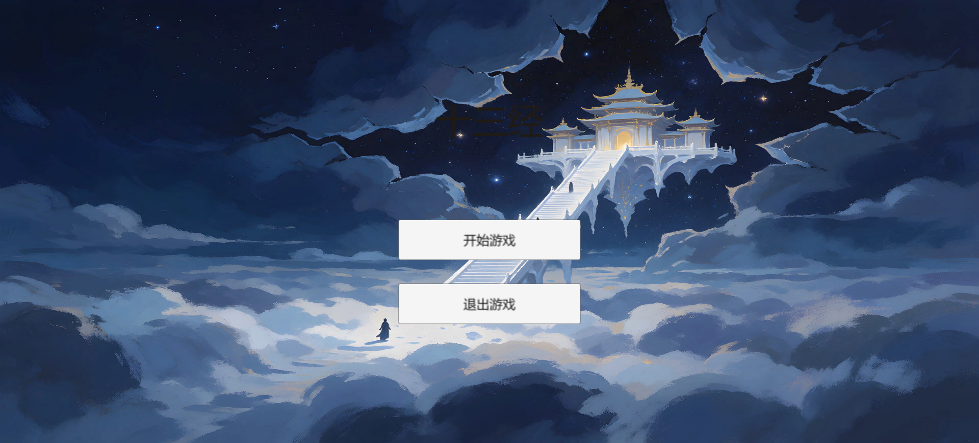
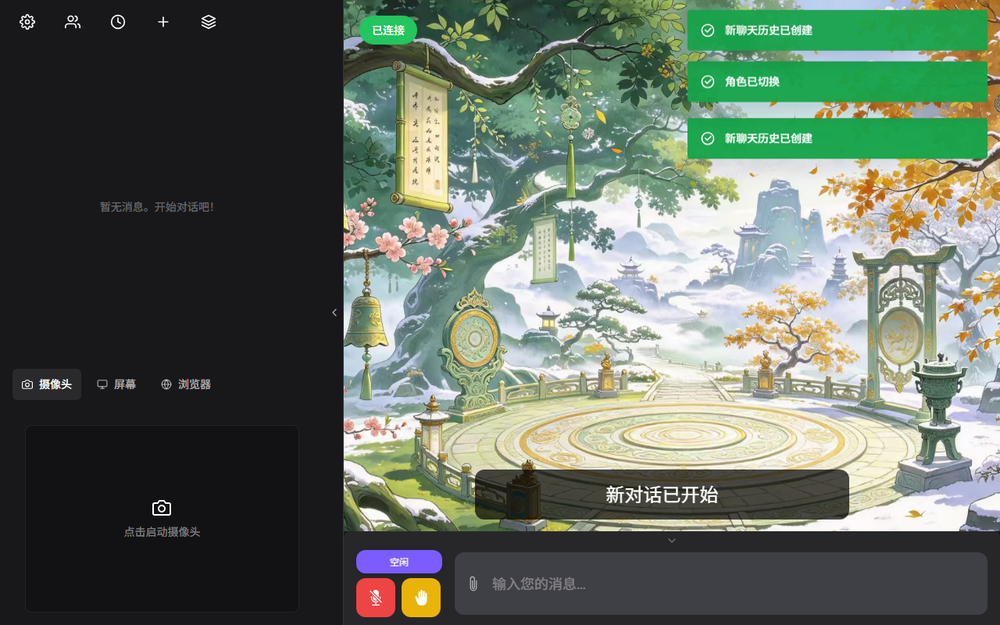

# 十三经 IP 游戏：用 Unity 把十三部经典做成可玩的剧情世界


**作品展示（B站）**：[十三经 IP 游戏作品演示](https://www.bilibili.com/zh-Hans/video/BV14BxL6XEGy/)

**技术栈**：Unity 2022.3 LTS（2D）+ C# + Live2D Cubism SDK + Open-LLM-VTuber

## 项目概述

「十三经」是儒家十三部经典的合称。「十三经 IP 游戏」把这些典籍拟人化为 13 个角色 IP，装进一个叫**典籍大陆**的世界里——玩家扮演「传礼者」，进入大地图逐个唤醒沉睡的经典，收集它们的记忆碎片，最终驱散笼罩典籍大陆的「遗忘之影」。

它既是一次传统文化 IP 的数字化尝试，也是一次完整的 2D 剧情游戏工程实践：**13 个 IP 全部可玩**，其中 2 个是 Live2D + AI 对话的体验关，另外 11 个是各有小玩法的剧情关。

## 世界观与角色设定

每部经典都有自己的性格与处境，例如：

- **周易**：典籍大陆的引路人，理性通透的智者，被历代注本撕裂成八个碎片。
- **尚书**：上古政令与史事的汇编，孤傲的治国诤臣。
- **诗经**：记忆歌者，以诗歌守护众生的情感记忆。
- **论语**：孔子及其弟子的言行录，一位温厚而仍会发问的师者。
- **孟子**：雄辩善思，倡性善、民贵的亚圣之书。

「遗忘之影污染了记忆花海」这类设定，把「传承文化」这个抽象目标，翻译成了玩家看得懂、有代入感的主线剧情。

## 大地图与关卡设计



进入游戏后是一张节点式大地图，13 个经典以图标形式排布。淡蓝色=可玩，灰色=占位，金色 ✓=已通关。点图标进入对应关卡。


关卡玩法按经典的性格量身定制，而不是千篇一律的答题：

| 经典 | 关卡玩法 |
| --- | --- |
| 周易 | 八易归一（对话式思辨） |
| 尚书 | 寻隐问诤臣 |
| 诗经 | 收集「风·关雎 / 雅·鹿鸣 / 颂·清庙」三片诗魂碎片 |
| 周礼 | 六官归位 |
| 仪礼 | 正名定分 |
| 礼记 | 通经致用 |
| 左传 | 编年迷宫 |
| 公羊传 | Live2D + AI 对话体验 |
| 谷梁传 | Live2D + AI 对话体验 |
| 论语 | 六艺 |
| 孝经 | 四镜 |
| 尔雅 | 名物之辨 |
| 孟子 | 义理台 |

其中 8 个「问—答—回应」式关卡继承同一个 `DialogueLevelBase` 基类，子类只需要提供「过关拼音 + 所有轮次内容」，其余流程自动复用。学诗经关卡那种自定义玩法就仿照 `ShijingLevel` 单独写。


## Live2D 角色的原生渲染

起初公羊传、谷梁传两个关卡是用 WebView 加载 Open-LLM-VTuber 的网页前端（WebGL 软渲染 Live2D），链路又重又脆，经常白屏。

改造方案是**直接用 Live2D Cubism SDK for Unity 在 Unity 里原生渲染**，彻底去掉网页层。运行时加载模型，程序化实现眨眼、呼吸、眼珠游移等动作。



这里有个实用的降级设计：代码里用 `LIVE2D_CUBISM` 宏做条件编译。**没导入 SDK 时不会报错也不会白屏**——自动显示一张静态立绘，游戏照样能跑；等导入 SDK 并在 Scripting Define Symbols 里加上宏，就自动切到动态 Live2D。

## AI 对话与语音

公羊传 / 谷梁传关卡的对话与 TTS 直接复用 Open-LLM-VTuber 的能力，模型侧接入大语言模型接口。为了让发布包「解压即玩」，用 PyInstaller 把服务器打包成 `run_server.exe` 随游戏一起分发。

## 一键生成场景

手工在 Unity 里搭 16 个场景（主菜单 + 大地图 + 13 关卡 + 结局）既枯燥又容易连错引用。于是写了一个编辑器工具 `SceneBuilder`：

菜单 **Tools → 十三经 → Build All Scenes**，一键生成全部场景并写入 Build Settings，各关卡脚本所需的按钮、文字引用都会自动连好。

新增关卡只需两步：写关卡脚本 → 在 `SceneBuilder.BuildAll()` 里加一行构建调用、并在 `SetBuildSettings()` 登记场景名。地图、按钮、结局计数全部自动适配。

## 打包与发布

`打包发布.py` 负责把三样东西组装成一个可直接分发的文件夹：

```text
十三经IP游戏/
├── 十三经IP游戏.exe      # Unity 构建产物
├── 十三经IP游戏_Data/    # 游戏数据
├── server/              # 内置 AI 服务器（含模型），游戏首次启动自动拉起
└── 启动说明.txt
```

对方解压后双击 exe 即可，不用装 Python 或 uv。首次启动会花十几秒加载语音/对话模型。

## 开发踩坑记录

### Live2D 白屏

**问题**：WebView + WebGL 软渲染链路脆弱，模型配置还错指向了 `mao_pro`。
**解决**：改用 Cubism SDK 原生渲染，并用宏做条件编译，保证没 SDK 时降级显示静态立绘。

### 从任意关卡直接 Play 时状态丢失

**问题**：不经过主菜单、直接在某个关卡场景点 Play 时，`GameManager` 不存在，「返回地图」记不了过关。
**解决**：用 `[RuntimeInitializeOnLoadMethod]` 在场景加载后自动补建 `GameManager` 单例。

### 场景手工搭建易错

**问题**：16 个场景的 Inspector 引用全靠手连，极易漏连。
**解决**：写 `SceneBuilder` 编辑器工具一键生成场景并自动接线。

## 项目亮点

- **文化 IP 化**：把 13 部典籍做成有性格、有处境、有主线的角色。
- **玩法差异化**：每个 IP 一种小玩法，贴合经典本身的性格。
- **AI + 活体角色**：Live2D 原生渲染 + 大模型对话 + TTS，角色真正「活」起来。
- **工程化**：一键生成场景、一键打包发布，内容可扩展。

## 结局彩蛋


集齐全部 13 部经典后，结局界面会在文字之上叠加一张全屏特殊 CG，并淡入呈现——十三经齐鸣，遗忘之影消散。